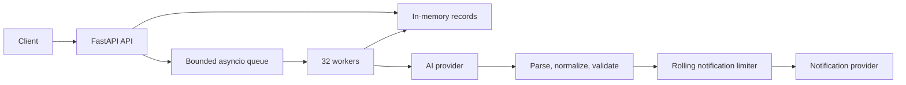

# Architecture and decisions

## Pipeline

The API performs no external call on the `/process` request path. It atomically accepts a queued ID once and returns `202`. Workers move `queued → processing → sent|failed`. `GET` reads the current state. A repeated `/process` call on an accepted ID is a no-op, including after failure, because replaying notification delivery could duplicate it.

One lock protects short updates to the request dictionary and queue acceptance. No lock is held across an HTTP call or rate-limit wait. The queue has 4,096 waiting slots and the store 10,000 records by default. At capacity, the API returns `503`; it never creates unbounded background tasks. Terminal records and queued requests that were never started can be pruned after the configured TTL, only when the store is full. This makes recent status checks available while keeping memory bounded.

## Exact provider contracts

`POST /v1/ai/extract` receives `{"messages":[{"role":"system","content":"..."},{"role":"user","content":"..."}]}` and requires `X-API-Key`. Its response is a chat completion with `choices[0].message.content`. That content is untrusted text. `POST /v1/notify` receives exactly `{"to":"...","message":"...","type":"email|sms"}` with the same header; a confirmed response contains `{"status":"delivered","provider_id":"..."}`. These shapes come from `provider/app.py`.

The system prompt requests one JSON object with an explicit recipient, message, and channel, refuses ambiguous cases, and tells the model to treat the user request as data. The mock ignores the system prompt for extraction but the prompt remains important for a real model and human evaluation.

## Guardrails

1. **Parse:** scan for exactly one complete brace-delimited object, then try strict JSON, Python-style single quotes, and simple unquoted keys. The parser has an input-size limit. It does not fill truncated braces or synthesize free-text fields.
2. **Normalize:** map only known aliases (`Recipient`/`destination`, `body`/`text`, `channel`/`method`) case-insensitively. Ignore unrelated metadata, but reject conflicting aliases and non-string fields.
3. **Validate:** require a nonempty message copied from the original request, exactly one recipient present in that request, and an `email` or `sms` channel matching that recipient. When `to` is omitted, use only the single address explicitly present in the user's text. When `type` is omitted, derive it only from the validated address format. Reject missing or invented messages, model refusals, malformed/truncated output, conflicting channels, and ungrounded recipients. Never call `/v1/notify` after validation fails.

The simulator sometimes returns an incomplete object or a refusal. Those requests intentionally become `failed`; “100% sent” would require unsafe guessing or changing the provider.

## Timeouts, retries, and rate limiting

An AI extraction call may take 1.5–3 seconds. HTTPX uses one connection pool across the process, and 32 workers cap in-flight jobs. AI calls time out after 6 seconds and may be retried twice on a timeout, connection error, `429`, or transient `5xx`, with short exponential waits. Extraction itself has no send side effect.

The provider allows 50 notification attempts per rolling 10-second interval. A lock-protected local sliding window reserves each attempt before sending. An explicit `429` means the provider declined that attempt, so the client can wait and retry it twice. Other notification errors, including timeout, connection loss and `5xx`, are **not retried**: the provider may already have accepted the message. Their request becomes `failed` with an uncertain external outcome. The provider contract has no idempotency key or delivery lookup that could resolve that uncertainty.

## Operational limits

The worker queue and state are volatile. Restarting the app loses pending and historical requests. Running multiple app processes would split IDs, queue ownership, and rate-limit accounting; keep one Uvicorn worker for this exercise. A production design needs durable state and work claims, cross-process throttling, and provider-side idempotency. The local limiter covers this app's outbound attempts but cannot account for other clients of the mock provider. Under sustained offered load above five delivered notifications per second, backlog grows until the bounded queue applies backpressure.
