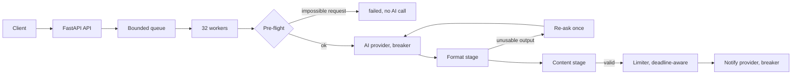

# Architecture and decisions

## Code layout

| Path | Responsibility |
| --- | --- |
| `app/main.py` | FastAPI entry point required by the challenge; wires settings, provider and pipeline |
| `app/pipeline.py` | Request store, bounded queue, worker pool and the stages of one job |
| `app/ai/prompts/` | `extraction_system.txt` and `retry.txt`, loaded once at startup; their hash is logged |
| `app/guardrails/output.py` | Format stage: raw model text → candidate fields (parse, lossless repair, aliases) |
| `app/guardrails/grounding.py` | Content stage: pre-flight on the request and validation of every field against it |
| `app/providers/http.py` | Exact HTTP contracts of `/v1/ai/extract` and `/v1/notify` |
| `app/providers/resilience.py` | Sliding-window limiter, circuit breaker, `Retry-After` parsing |
| `app/config.py`, `app/models.py` | Validated settings; public and domain models |

## Pipeline

`POST /process` makes no external call: it atomically enqueues the ID once and returns `202`. A worker then runs the job:

1. **Pre-flight.** Checks that depend only on the request (no recipient or several, invalid address, unsupported or conflicting channel) fail the job without an AI call; no model output could pass them.
2. **Extraction.** The model's text goes through the format stage and the content stage below. Only **unusable output** (a free-text refusal, no object, an irreparable object) is re-asked, once, with the fixed guardrail reason appended to the system prompt. The reason is a constant, never model or user text, so nothing untrusted reaches the system role, and the user message is unchanged. A protocol `REFUSED` is a decision and output that parses but contradicts the request would be repeated by a deterministic model, so neither is re-asked.
3. **Send.** The shared limiter reserves a provider slot, then the notification is sent once.
4. **Terminal state** `sent` or `failed`, with the reason logged.

Each job is isolated: any exception fails only that job, and an outer handler keeps a bookkeeping error from ending the worker. A **job deadline** (60 s from dequeue) bounds worker time; extraction can be cancelled, but an in-flight notification never is, because its outcome would become unknown. A repeated `/process` is a no-op, also after failure, so delivery is never replayed. The queue (4,096) and store (10,000) are bounded and return `503` at capacity; terminal records can be pruned after a TTL.

## Prompt

The system prompt defines the exact schema, copies the body verbatim and treats it as data that never justifies a refusal, explains connectors (`diciendo que`, `saying that`) and quotation marks, gives recipient and channel rules, one plain-text `REFUSED` protocol, and positive and negative Spanish examples. The user text is sent unchanged as the `user` message; wrapping it in tags would also change what the mock extracts. The mock ignores the system prompt, so prompt quality is measured with real models ([LLM evaluation](llm-evaluation.md)). A test requires the latest recorded evaluation to use the shipped prompt, so a prompt change needs a fresh run.

## Guardrails

The model proposes; the user's text is the source of truth.

**Format stage** (`output.py`). Require exactly one brace-delimited object; refusal text outside it or duplicate keys fail. Repairs are lossless only: single quotes and bare keys are re-tokenized without touching string contents, and an object cut off after its last complete string value (`... "type": "email" ...`) gets its `}`. Open strings, dangling keys and second objects are never completed. Known aliases (`Recipient`, `body`, `channel`, ...) are mapped; conflicting aliases and non-string values fail.

**Content stage** (`grounding.py`).

- Exactly one recipient must appear in the instruction part of the request. Email syntax uses `email-validator` without DNS, so a valid substring of a malformed address is never used. A missing `to` or `type` is recovered only from that single address.
- The message must be found in the request (ignoring case) and must not be the whole command.
- **Explicit body** (a colon right after the recipient): the text after it is authoritative. The model's message must equal it or be one of two lossless reductions, the tail after a later colon (the mock turns `cita a las 10:00` into `00`) or the body without wrapping quotes; the full source body is sent.
- **No delimiter:** the message must not overlap the recipient. This rejects the mock's fallback of the first 50 characters of the command (`enviar email a juan@example.com diciendo que su pa`). Casing and final punctuation are restored from the request. Descriptions such as `con un mensaje bonito` are rejected unless quoted.

Repairs apply only when the value can be read from the request without interpretation; everything else fails closed. With the bundled mock this means half of the k6 requests end as `failed` by design. These are conservative lexical rules, not a semantic classifier.

## Provider contracts, retries and rate limiting

`/v1/ai/extract` takes `system`/`user` messages and returns a chat completion; the adapter requires exactly one assistant choice with `finish_reason=stop`. `/v1/notify` takes exactly `{"to","message","type"}` and confirms with `{"status":"delivered","provider_id"}`. Both need `X-API-Key`.

- **AI calls** time out after 6 s and are retried twice on transport errors, `429` or `5xx`; extraction has no side effect.
- **Notifications** are limited locally to 50 per rolling 10 s (the provider's quota). Only an explicit `429` is retried (twice), honoring `Retry-After` with a shared cooldown. Timeouts, connection loss and `5xx` are **not retried**: the provider may already have accepted the message and offers no idempotency key.
- **Circuit breakers** on both providers open after 5 consecutive failures (a call with its retries counts once), fail fast for 10 s, then allow one probe. A `429` does not count; an open notify breaker fails before sending.

All settings are validated at startup (for example, a zero queue capacity would make `asyncio.Queue` unbounded).

## Limits

State and queue are in memory and per process: a restart loses requests, and several app processes would split IDs and rate accounting. Production would need durable state, a broker, distributed throttling and provider-side idempotency. Above five delivered notifications per second, the backlog grows until the bounded queue applies backpressure.
