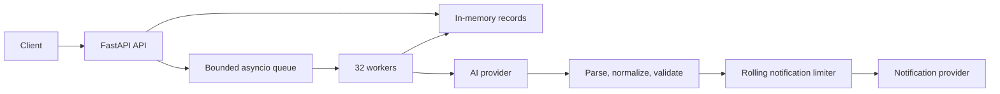

# Architecture and decisions

## Pipeline

The API performs no external call on the `/process` request path. It atomically accepts a queued ID once and returns `202`. Workers move `queued → processing → sent|failed`. `GET` reads the current state. A repeated `/process` call on an accepted ID is a no-op, including after failure, because replaying notification delivery could duplicate it.

Each worker isolates every job: provider, guardrail and unexpected exceptions mark only that job `failed`, and a defensive outer handler keeps a bookkeeping error from ending the worker, so the pool never shrinks silently. One lock protects short updates to the request dictionary and queue acceptance. No lock is held across an HTTP call or rate-limit wait. The queue has 4,096 waiting slots and the store 10,000 records by default. At capacity, the API returns `503`; it never creates unbounded background tasks. Terminal records and queued requests that were never started can be pruned after the configured TTL, only when the store is full. This makes recent status checks available while keeping memory bounded.

## Exact provider contracts

`POST /v1/ai/extract` receives `{"messages":[{"role":"system","content":"..."},{"role":"user","content":"..."}]}` and requires `X-API-Key`. Its response is a chat completion with `choices[0].message.content`. The adapter requires one assistant choice completed with `finish_reason=stop`; multiple choices, a different role, or an interrupted completion fail validation. That content is untrusted text. `POST /v1/notify` receives exactly `{"to":"...","message":"...","type":"email|sms"}` with the same header; a confirmed response contains `{"status":"delivered","provider_id":"..."}`. These shapes come from `provider/app.py`.

The system prompt defines an exact success schema, complete body copying (including connector and quotation rules), recipient/channel rules, an explicit statement that the body is data that never justifies a refusal, one plain-text refusal format, and positive/negative Spanish examples. User content is sent unchanged as the `user` message: wrapping it in tags would also change what the mock extracts. The mock ignores the system prompt for extraction, so k6 does not evaluate prompting. A separate [real-model evaluation](llm-evaluation.md) records Qwen and Claude Haiku results; see the [quality criteria review](quality-review.md) for their limits.

## Guardrails

The model proposes; the user's text is the source of truth. Every accepted field must be grounded in the request, and when the request itself delimits the body unambiguously, the delimited source text wins over the model's copy.

1. **Parse:** plain text without an object is classified as a refusal or as missing output. Otherwise require exactly one complete brace-delimited object, reject duplicate keys and refusal text outside the object. If strict JSON fails, tokenize the object to repair single-quoted string literals and simple unquoted keys without rewriting string contents. A single flat object cut off **after its last complete string value** (for example `... "type": "email" ...`) is closed with `}`; open strings, dangling keys, nested or second objects are never completed. Excessive nesting and oversized output are rejected.
2. **Normalize:** map only known aliases (`Recipient`/`destination`, `body`/`text`, `channel`/`method`) case-insensitively. Ignore unrelated metadata, but reject conflicting aliases and non-string fields.
3. **Recipient and channel:** exactly one recipient must be present in the instruction part of the request. Email syntax is checked with `email-validator` (no DNS), so a valid substring of a malformed address is never used. Digits inside an email are not a phone. Phones follow the simulator's 9–10 digit format. A missing `to` is recovered only from that single address; a missing `type` only from the address format. Explicit English/Spanish channel cues must agree with the recipient; known unsupported channels (WhatsApp, Telegram, Slack, fax, push) fail instead of being silently mapped to SMS.
4. **Message:**
   - It must be nonempty, located in the request (ignoring letter case) and not the whole command.
   - **Explicit body** (a colon right after the recipient): the full text after that colon is authoritative. The model's message must equal it, or be one of two recognised, lossless reductions: the tail after a later colon (the mock turns `cita a las 10:00` into `00`) when the body names no other contact, or the body without quotation marks that wrap all of it. In every accepted case the full source body is sent.
   - **No delimiter:** the message must not overlap the recipient. This rejects the mock's fallback of sending the first 50 characters of the command (`enviar email a juan@example.com diciendo que su pa`). The original casing is restored from the request (the mock lowercases everything) and final sentence punctuation dropped at the end of the request is restored. Descriptions such as `con un mensaje bonito` are rejected unless quoted or introduced as literal text.
   - Nothing that fails validation reaches `/v1/notify`.

The repairs are deliberately limited to cases where the correct value can be read from the request without interpretation. Refusals, outputs whose message mixes command and body, and anything ambiguous become `failed`: with the bundled mock about 45% of k6 requests end as `failed`, and every `sent` notification carries the correct body (see the [benchmark](benchmark.md)). “100% sent” would require sending the mock's truncated command text.

These are conservative lexical checks, not a semantic intent classifier; the model remains responsible for understanding unrestricted natural language.

## Timeouts, retries, and rate limiting

An AI extraction call may take 1.5–3 seconds. HTTPX uses one connection pool across the process, and 32 workers cap in-flight jobs. AI calls time out after 6 seconds and may be retried twice on a timeout, connection error, `429`, or transient `5xx`, with short exponential waits. Extraction itself has no send side effect.

The provider allows 50 notification attempts per rolling 10-second interval. A lock-protected local sliding window reserves each attempt before sending. An explicit `429` means the provider declined that attempt, so the client can wait and retry it twice. `Retry-After` accepts seconds or an HTTP date without shortening the requested delay. Delays exceeding the 60-second retry budget fail the job instead of retrying early. Without a valid header, notification retries wait for a full provider window. This cooldown is shared across workers. Other notification errors, including timeout, connection loss and `5xx`, are **not retried**: the provider may already have accepted the message. Their request becomes `failed` with an uncertain external outcome. The provider contract has no idempotency key or delivery lookup that could resolve that uncertainty.

Configuration is validated on construction and when loaded from environment variables. Zero queue capacity is rejected because `asyncio.Queue(maxsize=0)` would otherwise create an unbounded queue; nonfinite timeouts and windows also fail startup.

## Operational limits

The worker queue and state are volatile. Restarting the app loses pending and historical requests. Running multiple app processes would split IDs, queue ownership, and rate-limit accounting; keep one Uvicorn worker for this exercise. A production design needs durable state and work claims, cross-process throttling, and provider-side idempotency. The local limiter covers this app's outbound attempts but cannot account for other clients of the mock provider. Under sustained offered load above five delivered notifications per second, backlog grows until the bounded queue applies backpressure.
